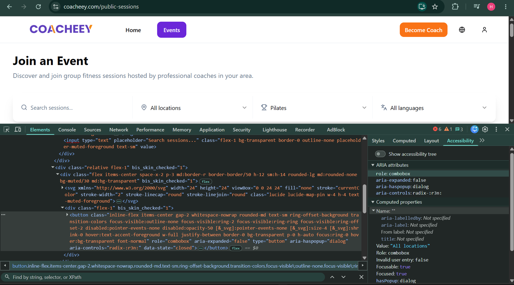
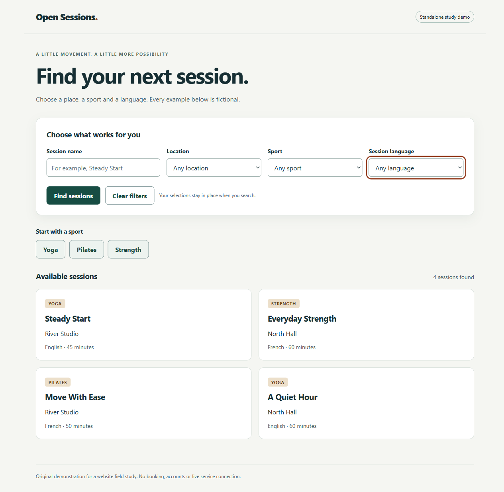
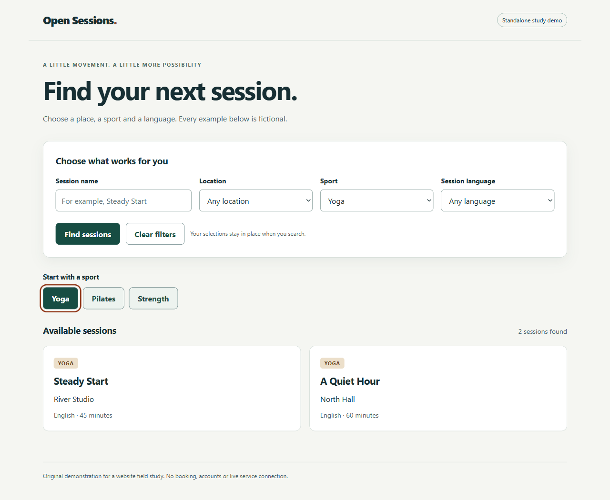

# Accessible discovery - Challenge demonstration

This standalone React/Vite project addresses the discovery-control problems recorded in B5 and B6. It uses fictional sessions and locations, original text and its own styling. No live-site code or assets were copied into the implementation, and the app has no connection to Coacheey, Eversports or a booking service.

## Problem and scope

The location, sport and language inspections expose empty computed accessible names. The recorded keyboard task also skipped sport shortcuts that worked with a mouse. Together, these make a central task harder to identify or operate without a mouse.

Baseline evidence: [location](../evidence/B5-location-accessibility.png), [sport](../evidence/B5-sport-accessibility.png), [language detail](../evidence/B5-language-accessibility-detail.png) and [Core B6 account](../review/report.md). The language image is a contextual crop, and B6 is a reported task observation rather than a DOM audit.

The demo keeps the scope small: name each filter, offer keyboard-operable sport shortcuts, apply filters without losing values, and recover from an empty result. It is a demonstration of the idea, not a patch deployed to the audited service.

## Run locally

Development used Node 22.17.0. Dependencies are pinned in package.json and package-lock.json.

```sh
npm ci
npm run dev
```

Open the printed localhost address. To build and preview:

```sh
npm run build
npm run preview
```

Both servers bind to 127.0.0.1. The project does not send form data, register users or make bookings.

## Design decision

Native `select` elements with explicit `label`/`htmlFor` associations replace custom combobox behaviour. This gives each field a persistent purpose name and familiar keyboard interaction with less custom event handling. The trade-off is less control over the opened menu's appearance. The sport shortcuts are native buttons, with `aria-pressed` reflecting the applied sport. A visible focus outline and skip link support the same keyboard journey.

Filters are applied on submission and retained afterward. A polite status message reports the result count; the empty state offers a clear reset. All fields are optional, so this project does not claim to fix the untested B4 validation behaviour.

## Before and after - actual results

The **before** column uses student-supplied Coacheey evidence. The **after** column is AI-run verification of this local demo, not student fieldwork. Detailed results, time and browser are in [verification-results.json](verification/verification-results.json).

| Check | Before: recorded Coacheey behaviour | After: verified demo behaviour |
|---|---|---|
| Three filter names | Location, sport and language computed names are empty | Three named comboboxes: Location, Sport, Session language |
| Label association | No associated label specified in the inspected filter details | All four label clicks focused their corresponding fields |
| Yoga shortcut | Not reached with Tab in the recorded task; mouse click opens results | Reached in seven Tab presses after main; visible focus; Enter returns two fictional Yoga sessions |
| Selection retention | Not measured as an original-site improvement baseline | Yoga and French remain selected after applying a zero-result combination |
| Empty-state recovery | B2 already explains no matches and suggests recovery | zzzqqq produces an empty state; Show all sessions restores all four examples |
| Small-screen layout | No controlled original-site comparison claimed | No horizontal overflow at a 390 CSS-pixel viewport |

The production build and all 15 local browser checks passed. See the [verification record](verification/verification.md). These measurements do not imply full accessibility, production suitability or a causal whole-page Lighthouse improvement. The different starting points also mean the seven-Tab count is not a before/after speed metric.

### Original inspection



### Demo after the change





## Manual review to perform yourself

1. Tab from the address bar and activate the visible skip link.
2. Click each visible label; confirm its field receives focus.
3. Reach Yoga with Tab, press Enter and confirm two results.
4. Apply Yoga and French, then confirm zero matches without losing the selections.
5. Use Show all sessions; confirm four examples and reset fields.
6. Inspect each combobox name separately from its value.

Record actual results and, if required, capture your own after screenshots in verification/student/. Existing after images are AI-captured and remain labelled as such.

## Assistance and originality

AI prepared this implementation and its initial local verification from the supplied evidence and observations. It is original demonstration code, not copied site code, but it is not unaided student work. The student must inspect, understand and revise it, disclose the assistance and confirm that this degree of help is permitted for the Challenge. The same distinction applies to the after screenshots and measurements.

Documentation consulted: [React createRoot](https://react.dev/reference/react-dom/client/createRoot), [Vite guide](https://vite.dev/guide/), [MDN label element](https://developer.mozilla.org/en-US/docs/Web/HTML/Reference/Elements/label).
