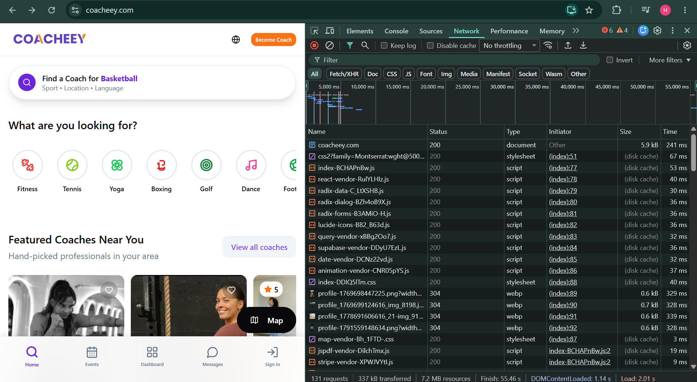
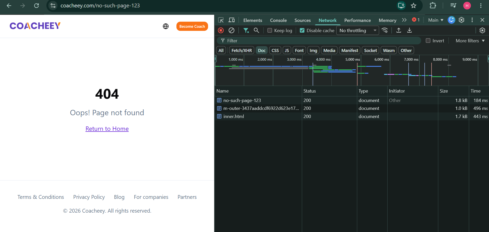
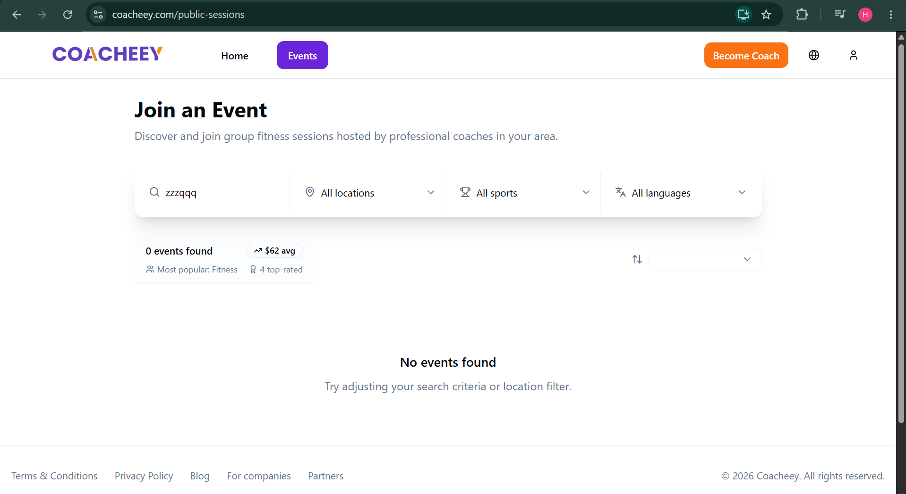

# Coacheey website field study

Haytam CHARAFI | 2303060049 | SFWE475 / CPRG201

Website: https://coacheey.com/ | Organisation/brand: Coacheey

Prepared: 10 November 2026 | Core audit, with separate Stretch and Challenge material

Recorded Lighthouse audit dates: 9 November UTC; Eversports run falls on 10 November in Europe/Bucharest. Browser recorded by these exports: Chrome 156 on 64-bit Windows. Other capture dates and full browser builds were not recorded.

## Scope and method

Coacheey is a platform for finding coaches and booking training sessions. Its public pages also list group events in Luxembourg. This review looks at the steps before booking: searching for a session, reading a coach profile and dealing with empty results or a lost connection. The evidence comes from the student's screenshots, keyboard observations and saved Lighthouse reports. No login, booking, payment or message was submitted. The screenshots use different responsive layouts because DevTools was docked in different positions; exact viewport sizes were not recorded. The findings apply to the pages and states shown.

<!-- note -->
AI assisted organisation, explanation of the supplied evidence, English, drafting and PDF layout. The student must check this wording against their own work and the course's permitted use of AI. Missing observations have not been filled with invented results. The Challenge code and local checks have separate AI attribution in fix/README.md.

# Part A - Technical behaviour

## A1 - HTTPS and redirects

The HTTP address was reported to return to HTTPS, and Chrome showed a valid certificate. This means the browser accepted the certificate and the connection was encrypted during that check. The individual redirect steps and certificate dates were not copied into the notes. The evidence therefore supports the final HTTPS address and valid-certificate result; it does not prove that every part of the service is secure. [A1]

## A2 - URL structure

All five addresses are lowercase and use no underscores. Most paths give a useful idea of the page, although /auth is less clear to a new visitor than a word such as sign-in. The filtered coach address is difficult to read because the city and sport are long identifiers. It still uses only two query parameters, both related to the search. The Events Lighthouse export confirms HTTPS; the other four screenshots hide the scheme, so that rule stays unconfirmed for those addresses. [A2]

<!-- widths: 198,50,70,53,74,70.28 -->
| Recorded browser address | HTTPS | Short / readable | Lowercase | Hyphens, not underscores | Few parameters |
|---|---|---|---|---|---|
| coacheey.com/public-sessions | Pass: export | Pass | Pass | Pass | Pass: 0 |
| coacheey.com/coaches?city=d3e88837-bff6-444e-8ba8-13906ae37e0b&sport=37644da5-c4da-46f2-883a-84da3c98e1c4 | Unknown | Fail: UUIDs | Pass | Pass | Pass: 2 |
| coacheey.com/auth | Unknown | Pass; technical | Pass | Pass | Pass: 0 |
| coacheey.com/coach/bee-mindful-3b6ad569 | Unknown | Pass | Pass | Pass | Pass: 0 |
| coacheey.com/for-coaches | Unknown | Pass | Pass | Pass | Pass: 0 |

<!-- note -->
Addresses are transcribed as displayed; hidden schemes have not been added as verified observations. The readable coach name is followed by a short identifier, which helps distinguish profiles without making the whole path opaque.

<!-- pagebreak -->

# Part A - Requests and caching

## A3 - One request, closely

The homepage document uses GET https://coacheey.com/ and returns 200 OK with Content-Type text/html; charset=utf-8. A separate Network overview shows 131 requests, 337 kB transferred and 7.2 MB of resources, with No throttling and caching enabled. These sizes differ because transferred data is not the same as the full size of the resources available to the page. The Fetch/XHR screenshot also shows a successful GET to /rest/v1/public_coach_profiles. This suggests that the browser requests coach data separately from the page document. Its full request query was not copied. [A3]

<!-- image-size: 395.38,220 -->

<!-- note -->
Figure 1. Homepage Network overview. Totals belong to this capture; the separate headers and Fetch/XHR images supply the request details.

## A4 - A missing page

The made-up address https://coacheey.com/no-such-page-123 shows "404", "Oops! Page not found" and a "Return to Home" link. However, the document returns 200 even when Disable cache is checked. This is a soft 404: the page says it is missing, but the response code says the request succeeded. The home link helps a visitor recover. Returning an actual 404 would also let search engines and broken-link tools recognise the missing page correctly. [A4]

## A5 - Cache-Control

The HTML document uses no-cache, while the inspected JavaScript asset can stay fresh in a cache for one year. The table explains the two policies. This allows the browser to check whether the HTML has changed while reusing an unchanged script. The full script address was not captured in the notes, so the evidence supports the header reading without identifying that resource completely. [A5]

<!-- widths: 100,188,227.28 -->
| Resource | Recorded Cache-Control | Meaning |
|---|---|---|
| Homepage HTML | no-cache | Storage is allowed, but the stored response must be validated before reuse. |
| Inspected JavaScript asset | public, max-age=31536000, immutable | Browser/shared caches may keep it fresh for one year without routine freshness revalidation; changed content should use a different asset URL. |

<!-- pagebreak -->

# Part A - Rendering and page metadata

## A6 - Where the page is built

The raw source already includes "Find Your Perfect Coach in Luxembourg", a paragraph and links. The live Elements view instead shows "Find Your Perfect Coach" with different surrounding markup. This supports a mixed classification: useful content arrives in the initial HTML, and the browser then changes the page. These screenshots cannot show whether the initial HTML was generated for that request or prepared earlier. JavaScript files alone would not be enough to call the page browser-rendered. [A6]

## A7 - SEO basics

The title and description explain the service and its location. The canonical link identifies the preferred homepage address, and lang=en identifies English as the page language. The live heading search finds one h1. The source and live titles differ, but the reason is unknown. The inspected page has no anchors matching sponsored or ugc; whether either attribute was needed was not established, so this is not reported as a fault. [A7]

<!-- widths: 105,410.28 -->
| Item | Recorded value or result |
|---|---|
| Source title | Find Your Sport Coach in Luxembourg - 50+ Sports \| Coacheey |
| Live title | Sport Coaches in Luxembourg \| Find Your Perfect Trainer |
| Meta description | Find certified sport coaches in Luxembourg. Tennis, yoga, fitness, boxing & 50+ sports. Book online from EUR20/session. |
| Canonical | https://coacheey.com/ |
| html lang | en |
| h1 | One live match: Find Your Perfect Coach. The count screenshot is cropped. |
| sponsored / ugc | No matching anchors in the inspected DOM; applicability remains unconfirmed. |

<!-- image-size: 463.69,220 -->

<!-- note -->
Figure 2. Coacheey's friendly missing-page interface beside the fresh HTTP 200 response. The distinction between visible message and protocol status is the A4 finding.

<!-- pagebreak -->

# Part B - Waiting and recovery

## B1 - Loading state

The MEC Movement profile first shows placeholders for the picture, avatar and text, then displays the coach's details. The student confirmed that both screenshots came from the same reload. The selected preset is labelled 3G, rather than Slow 3G; caching is enabled and the document returns 304. The placeholders give a useful indication that content is loading. No elapsed screenshot times were recorded, so this pair shows the loading stages but cannot establish how long a visitor waited. [B1]

<!-- image-pair: B1-mec-loading.png,B1-mec-loaded.png -->

<!-- note -->
Figure 3. The same profile during loading and after content appears. Original captures are retained; the interval between them is unknown.

## B2 - Empty state

Searching Events for zzzqqq shows "0 events found", "No events found" and "Try adjusting your search criteria or location filter." The visitor gets both an explanation and a next step. However, "$62 avg", "Most popular: Fitness" and "4 top-rated" remain visible. It is unclear whether these figures refer to all events or the current results, which could confuse someone seeing zero matches. This screenshot does not establish that the calculations themselves are wrong. [B2]

<!-- image-size: 402.63,220 -->

<!-- note -->
Figure 4. The impossible query returns a clear empty state, but summary statistics remain visible.

## B3 - Error state

Reloading Events with Network set to Offline shows Chrome's ERR_INTERNET_DISCONNECTED page and failed or cancelled document requests. The advice is supplied by Chrome, not Coacheey, and this result contains no site-specific retry button. This tests a full-page reload; it does not show how an already loaded search handles losing its connection. Later screenshots show that online activity resumed, but the exact step used to restore the connection was not recorded. [B3]

<!-- pagebreak -->

# Part B - Controls and accessibility

## B4 - Form validation

Events search was used for the public field checks. No form was identified where an incomplete submission was known to block sending; account and booking actions were excluded. Validation is **not tested safely**, so error wording, placement and input retention remain unknown. This is a review limitation. [B4]

## B5 - Field labels

The Events textbox gets its name from a placeholder, with no separate visible label. Location, sport and language have empty computed names: their selected values do not name the field's purpose. The language screenshot is a supporting crop. The header globe is correctly named "Change language". Sort remains unverified. [B5]

<!-- widths: 80,85,110,110,130.28 -->
| Field | Visible label | Accessible name | Label click-to-focus | Finding |
|---|---|---|---|---|
| Search | Placeholder only | Search sessions... | N/A: no separate label shown | Named, but no persistent visible label |
| Location | No separate label shown | Empty; value All locations | N/A: no separate label shown | Purpose name missing |
| Sport | No separate label shown | Empty; value Pilates | N/A: no separate label shown | Value does not identify purpose |
| Language | No separate label shown | Empty in inspection detail | N/A: no separate label shown | Crop relies on inspection context |
| Sort | No text in overview | Unverified | Not tested | Appearance alone does not establish a missing name |

## B6 - Keyboard-only task

Tab and Enter reached Events with visible focus and no trap. The reported header order was logo, Home, Events, Become Coach; no skip link appeared. Tab skipped the sport shortcuts under "What are you looking for?", while a mouse click on Yoga opened results. Header navigation worked, but those shortcuts were unavailable in the same way. Their HTML and alternative routes were not inspected. [B6]

## B7 - Lighthouse Accessibility

The homepage scores 94 and Events 93. Both exports use Accessibility-only desktop settings with screen emulation disabled. Audit times are 2026-11-09 11:15:54.972 UTC and 11:42:54.478 UTC; the Events export differs from its earlier screenshot run. The three distinct warnings are low contrast and no main landmark on both pages, plus heading order on Events. These suggest reading/navigation barriers. A high score does not replace manual checks or prove full accessibility. [B7]

## B8 - Link and button wording

"Read more" relies on its event card to explain the destination. Adding event context would help. The three filters also need purpose names independent of their selected values. The table suggests wording for these four controls; other icons are not called unnamed without evidence. [B8; B5]

<!-- widths: 85,125,155,150.28 -->
| Control/context | Current text or name | Proposed wording | Evidence |
|---|---|---|---|
| Events card | Read more | Read about this Pilates event | B2/B5 overview; preserve association with the event title |
| Location filter | All locations; computed name empty | Filter by location | B5-location-accessibility.png |
| Sport filter | Pilates; computed name empty | Filter by sport | B5-sport-accessibility.png |
| Language filter | All languages; computed name empty | Filter by session language | B5-language-accessibility-detail.png; cropped supporting evidence |

<!-- pagebreak -->

# Part C - Priorities for improvement

## What works well

**Helpful empty-search feedback.** Events explains that nothing matched and suggests changing the search criteria. This helps the visitor decide what to try next. [B2]

**Useful loading placeholders.** Coach profiles show the shape of the content before the details arrive. This gives feedback during the wait, although it does not prove that loading is fast. [B1]

**Reason for this order:** finding a session is the main visitor task, readable text is needed throughout that task, and the missing-page response mainly affects search engines and tools checking broken links.

## 1 - Make discovery controls identifiable and keyboard-operable

**Problem:** three filters have no accessible purpose name, and Tab skipped sport shortcuts that worked with a mouse. **Evidence:** the B5 control inspections and B6 keyboard task. **Who it affects:** visitors using a keyboard or assistive technology to find sessions. **Fix:** add visible labels connected to the filters and use controls that work with both mouse and keyboard for the sport shortcuts. **Effort: medium**, because the controls need checking in different states. **Impact: high**, because they are part of the main search task. **Check:** every filter announces its purpose and selected value, and Tab then Enter opens the Yoga results. [B5; B6]

## 2 - Improve text/background contrast

**Problem:** Lighthouse flags low contrast on the home and Events pages. **Evidence:** the two original B7 reports. **Who it affects:** people with low vision or anyone reading in bright light. **Fix:** find the flagged text and adjust its foreground or background colour, including hover and focus states. **Effort: medium**, because shared styles and several states need checking. **Impact: high**, because visitors need to read the information before choosing a session. **Check:** the affected colour combinations pass the same contrast check on both pages and remain readable during a manual review. These effort and impact ratings are estimates. [B7]

## 3 - Make missing-page status agree with its message

**Problem:** the missing-page screen returns 200 instead of 404. **Evidence:** the fresh A4 capture with caching disabled. **Who it affects:** visitors following broken links, and services that check or index those links. **Fix:** keep the friendly message and home link, but return 404 for an unknown address. **Effort: medium**, because the hosting and routing setup is unknown. **Impact: medium**, because accurate responses help identify broken links. **Check:** the made-up address returns 404 with caching disabled and the home link still works. The benchmark shows why Coacheey should keep its recovery screen while correcting the status. [A4; S1/A4]

## Limits of this review

<!-- note -->
The screenshots do not supply most capture timestamps, the loading pair has no measured interval, validation was not tested, and the sort control remains unverified. The study identifies specific behaviours; it does not establish business impact, complete accessibility or whole-site conformance. Git history and submission tasks are recorded separately in REVIEW-AND-FILL.md.

<!-- pagebreak -->

<!-- evidence-log -->
